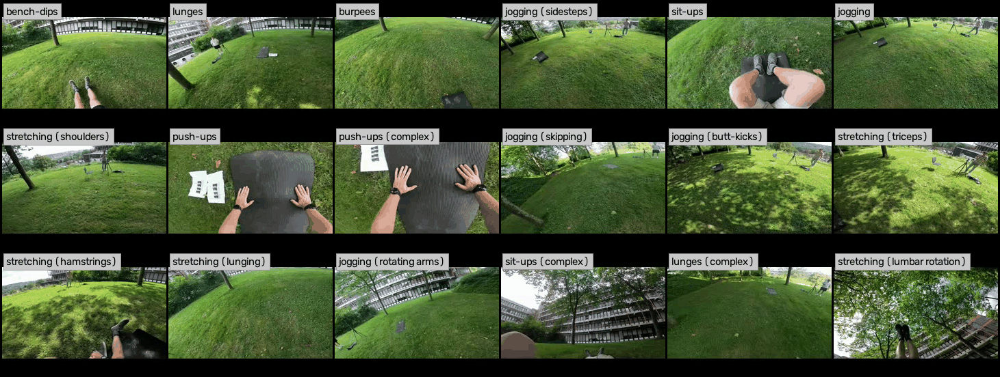
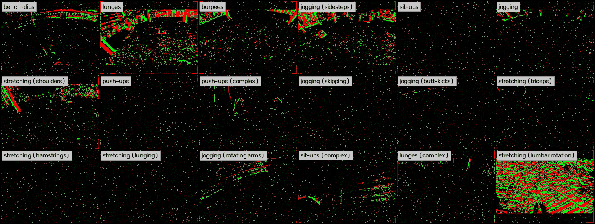
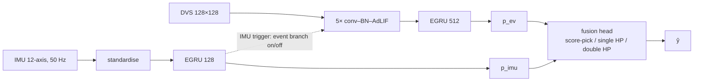

# N-WEAR: Spiking Event–Inertial Fusion with Hopfield Pooling for Energy-Efficient Egocentric Activity Recognition

F. Sholichin<sup>1</sup>, M. Neumeier<sup>2</sup>, S. Gröttrup<sup>1</sup>, T. Schön<sup>1</sup>

<sup>1</sup> *Technische Hochschule Ingolstadt, Ingolstadt, Germany*
<sup>2</sup> *fortiss GmbH, Neuromorphic Computing, Munich, Germany*

Correspondence: `fauzisholichin@gmail.com`

---

<p align="center">
  
  
</p>
<p align="center"><em>Left: RGB clips of the 18 activities from the <a href="https://mariusbock.github.io/wear/">WEAR</a> dataset.
Right: the corresponding event streams, converted with <a href="https://github.com/SensorsINI/v2e">v2e</a>.</em></p>

## Abstract

Head-worn devices must recognise what their wearer is doing, yet running a frame
camera and a video network continuously exceeds the energy budget of a battery-powered
headset. We study a fully spiking alternative on WEAR, an egocentric benchmark that
pairs head-mounted video with four-limb inertial data. The video is converted into a
128×128 event stream with v2e, and two directly trained spiking encoders, a
convolutional adaptive-LIF network with an event-based GRU for events and an
event-based GRU for inertial data, are fused late by two deployable Hopfield-pooling
heads: a single head that pools the two modality tokens of one window, and a double
head that first pools time within each modality and then pools across modalities. All
models are scored over 54 leave-one-subject-out runs on two window sets, native and
event-aligned, each with and without the 10 s majority vote of the WEAR protocol. On
the shared 45,243 aligned windows the spiking pipeline matches the best conventional
RGB–inertial fusion (83.07 vs. 82.32 % macro F1 without the vote, 85.09 vs.
85.16 % with it). The vote changes which fusion head ranks first: double Hopfield
pooling leads without it, but with it the three spiking heads lie within 1.5 F1 points,
because the vote supplies the temporal context that the double head learns. Energy is
estimated with NeuroBench, extended to the operators it does not count. With sensors
included, the event pipeline needs 37–93× less energy per window than camera,
I3D and TriDet; the fusion head is 0.11 % of the spiking pipeline, and an IMU-gated
schedule skips 18 % of the event branch at a retention of 0.997–1.000.

## Status

Code release accompanying the paper (NICE 2027). The repository contains the full
pipeline (event conversion, both spiking encoders, the SIM A baselines, all fusion
heads, evaluation, energy accounting and the IMU-gated schedule) and the per-fold
results behind every table. Checkpoints and the converted event data will be released
separately. Read [docs/KNOWN_ISSUES.md](docs/KNOWN_ISSUES.md) before re-running or
extending the experiments.

## Contributions

1. **An event-based version of WEAR.** The egocentric video is converted into
   DVS 128×128 events with v2e, synchronised with the inertial stream, and used to train
   a spiking event encoder and a spiking inertial encoder under the 54-run
   leave-one-subject-out protocol of WEAR.
2. **Two deployable late-fusion heads based on modern Hopfield pooling.** *Single*
   Hopfield pooling across the two modality tokens of one window, and *double* Hopfield
   pooling, which pools a temporal context within each modality before pooling across
   modalities. Both run on conventional (RGB–inertial) and spiking front ends.
3. **A protocol-complete comparison.** Every model is scored on native and on
   event-aligned windows, each with and without the WEAR 10 s vote. The vote reorders
   the fusion heads.
4. **An energy analysis with NeuroBench**, extended to the event-based GRU, the
   adaptive-LIF neuron and Hopfield pooling, at the encoded-input and the from-sensor
   boundary, together with an IMU-gated schedule for the visual branch.

## Method



*The spiking pipeline (SIM B). Both encoders are frozen after training and emit 18
activity scores per 2 s window; a late-fusion head combines them. The IMU branch is
always on and can gate the event branch (dashed).*

### Data, event conversion and two front ends

WEAR records 18 participants (subjects 0–17 form the leave-one-subject-out cohort)
performing 18 workout activities outdoors, with a head-mounted camera at 60 fps and
four accelerometers on wrists and ankles at 50 Hz. All models use a 2 s window.

- **SIM A (conventional).** The published WEAR features: two-stream I3D embeddings
  (2048-D per window) and the 12-axis inertial windows. Camera TriDet, inertial TriDet
  and Attend-and-Discriminate (A&D) are retrained on our folds and emit per-frame
  (50 Hz) labels and scores. Two pairings are fused: **BF1** = A&D + camera TriDet and
  **BF2** = inertial TriDet + camera TriDet.
- **SIM B (spiking).** Each annotated activity segment of the video is cut into 2 s
  chunks, letterboxed to 128×128, temporally upsampled with Super SloMo until
  interframe motion is below one pixel, and converted with v2e under its
  bright-illumination model with a nominal contrast threshold of 0.2. This yields
  15,100 clips over 557 activity segments, about 0.26 M events per clip. Events are
  binned into a two-polarity count tensor of T = 100 bins of 20 ms, the same grid as
  the 100 inertial samples of a window. v2e is a training surrogate for a physical DVS;
  it is not part of the deployed pipeline and is not charged energy.

### Spiking encoders

- **Event encoder.** Five strided convolution blocks (convolution, batch normalisation,
  SE-AdLIF neuron, dropout) reduce each 2×128×128 time step to 3136 features without
  pooling layers. An EGRU with 512 units, a linear layer and a leaky-integrator readout
  produce 18 logits, averaged over the 100 steps. Training augments the event tensor
  with horizontal mirroring (p = 0.5), circular shifts of up to 4 px and entry dropout
  (p = 0.05).
- **Inertial encoder.** The 12 standardised channels (statistics from training subjects
  only) feed an EGRU with 128 units directly. A unit transmits only when its state
  crosses a learned threshold, so activations and recurrent traffic are sparse. The
  head outputs 19 logits (18 activities and NULL); at evaluation and as fusion input
  only the 18 activity logits are used.

Both encoders are trained with surrogate-gradient backpropagation through time in
[SpikingJelly](https://github.com/fangwei123456/spikingjelly).

### Deployable late fusion with Hopfield pooling

All heads consume the frozen per-modality scores and never see the ground truth. The
Hopfield heads are conventional (float) attention layers that run on a host next to the
spiking front end.

- **Score-pick** adopts, per window, the prediction of the more confident modality. It
  is untrained and is the lower bound a learned head must beat.
- **Hopfield pooling** retrieves, for a set of tokens **Y**,
  `HP(Y) = softmax(β · q (Y W_K)ᵀ) Y W_V`, with a learned query **q**, one head and
  β = 0.1, iterated up to three times.
- **Single Hopfield pooling** projects the two modality features of one instant to
  d = 64, pools them as N = 2 tokens and maps the pooled vector to 18 logits. It has no
  temporal context.
- **Double Hopfield pooling** pools each modality's sequence over time (a
  linear–LayerNorm–ReLU stem to d = 128, then HP<sub>time</sub>), pools the two
  modality summaries with HP<sub>fus</sub>, and classifies with LayerNorm + linear.
  On SIM A the context is W = 100 frame-level score vectors (2 s at 50 Hz); on SIM B it
  is W = 5 aligned windows at −4, −2, 0, +2, +4 s (about 10 s). Because the modalities
  meet only at the second level, each branch can be trained, run and switched off
  independently.
- **Oracle** (reference only) keeps a correct modality prediction whenever one exists.
  It consults the label and bounds what any operator could extract from the two frozen
  score streams.

Heads are trained per fold on the training subjects with Adam; the checkpoint with the
lowest training loss is kept, so the held-out subject never selects a model.

## Evaluation protocol

WEAR leave-one-subject-out over subjects 0–17 with three seeds (54 runs), reported as
mean ± standard deviation over runs. Scores are 18-class macro F1 and accuracy on
activity windows: ground-truth NULL is removed (the event stream exists only inside
activity segments), and a NULL prediction on an activity window counts as an error.
WEAR leaves two choices open that change every number, so all four combinations are
reported.

| Setting | Definition |
| --- | --- |
| **Native** windows | All 95,439 activity windows of the inertial timeline (2 s windows, 1 s stride). For SIM B the frozen event encoder is re-run on the 2 s event crop centred on every native window; the crop fits inside an event segment for 87,315 windows (91.5 %). |
| **Aligned** windows | The 45,243 windows (2 s apart) on which an event clip and an inertial window coincide. The only set on which every model sees identical windows. |
| **No vote** | The raw window decision, which is what a causal device outputs. |
| **10 s vote** | The WEAR majority vote on predicted labels: ±5 s on the native grid, five consecutive windows on the aligned grid, restarted at gaps. It is centred and reads up to 4–5 s of future windows. |

## Results

### Recognition

18-class macro F1 (%), mean over 54 runs. Standard deviations and accuracy are in
Table I of the paper. **Bold**: best deployable head per front end and column (oracles
excluded). A&D<sup>18</sup> takes the argmax over its 18 activity probabilities, the
rule the IMU SNN uses; A&D<sup>∅</sup> may predict NULL, as in BF1.

| Model | Native, no vote | Native, 10 s | Aligned, no vote | Aligned, 10 s |
| --- | ---: | ---: | ---: | ---: |
| ***SIM A single modality*** | | | | |
| A&D<sup>18</sup> (IMU) | 81.14 | 86.75 | 77.87 | 82.21 |
| A&D<sup>∅</sup> (IMU) | 76.28 | 80.67 | 73.31 | 77.01 |
| TriDet (IMU) | 77.86 | 78.44 | 74.39 | 75.05 |
| TriDet (camera) | 76.30 | 77.06 | 73.10 | 74.06 |
| ***SIM A fusion, BF1 = A&D<sup>∅</sup> + camera TriDet*** | | | | |
| Score-pick | 77.66 | 81.84 | 74.56 | 78.16 |
| Single Hopfield | **85.97** | **89.28** | **82.32** | **85.16** |
| Double Hopfield | 84.04 | 86.15 | 80.43 | 82.10 |
| *Oracle* | *92.68* | *93.82* | *88.82* | *89.83* |
| ***SIM A fusion, BF2 = inertial TriDet + camera TriDet*** | | | | |
| Score-pick | 85.50 | 86.10 | 81.82 | 82.48 |
| Single Hopfield | 83.59 | 84.24 | 80.05 | 80.85 |
| Double Hopfield | 82.68 | 83.24 | 79.03 | 79.66 |
| *Oracle* | *92.70* | *93.30* | *88.76* | *89.47* |
| ***SIM B (spiking) single modality*** | | | | |
| IMU SNN | 76.40 | 82.24 | 75.83 | 81.14 |
| Vision SNN | 54.39 | 66.27 | 55.11 | 64.89 |
| ***SIM B fusion, IMU SNN + Vision SNN*** | | | | |
| Score-pick | 77.87 | **85.68** | 77.74 | **85.09** |
| Single Hopfield | 78.81 | 85.38 | 78.68 | 84.77 |
| Double Hopfield | **83.50** | 84.23 | **83.07** | 84.02 |
| *Oracle* | *85.93* | *91.97* | *85.82* | *91.28* |

Key findings:

- **The spiking pipeline matches the best conventional fusion on shared windows:**
  83.07 vs. 82.32 % F1 without the vote (double Hopfield vs. BF1 single Hopfield) and
  85.09 vs. 85.16 % with it.
- **Every Hopfield head on the spiking front end improves on the IMU SNN.** Without the
  vote, double Hopfield pooling reaches 83.07 % F1 (+7.24 over the IMU SNN) and
  88.40 % accuracy, within 1.95 accuracy points of the oracle, although the event
  stream alone is 20.7 F1 points weaker than the inertial one.
- **The vote reorders the spiking heads.** With the 10 s vote the three spiking heads
  lie within 1.1 (aligned) and 1.5 (native) points. The vote adds 7.35 points to
  score-pick but only 0.95 to double Hopfield pooling: both supply about 10 s of
  temporal context, so the gains do not add up. After the same five-window vote,
  average mAP (tIoU 0.3–0.7) on aligned windows is 69.54 % for double pooling against
  63.21 for single pooling and 59.89 for score-pick (oracle 76.16).
- **The vote rewards window classifiers, not detectors:** +0.6–1.0 F1 for the two
  TriDet models, but +4.3–5.6 for A&D, +5.3–5.8 for the IMU SNN and +9.8–11.9 for the
  vision SNN.

### Energy

Workload and energy per 2 s window at the encoded-input boundary. SIM A counted densely;
SIM B with NeuroBench 2.3.0 over 54 runs. Energies are arithmetic proxies
(E<sub>MAC</sub> = 4.6 pJ, E<sub>SOP</sub> = 10 pJ, E<sub>neuron</sub> = 5 pJ), not
hardware measurements. TriDet (camera) excludes I3D.

| Component | Dense (M) | Eff. MAC (M) | Eff. AC (M)<sup>†</sup> | Sparsity (%) | Dense (mJ) | Sparse (mJ) |
| --- | ---: | ---: | ---: | ---: | ---: | ---: |
| A&D (IMU) | 238.632 | – | – | – | 1.0977 | – |
| TriDet (IMU) | 18.678 | – | – | – | 0.0859 | – |
| TriDet (camera) | 19.999 | – | – | – | 0.0920 | – |
| Event SNN<sup>‡</sup> | 1687.450 | 2.890 | 106.172 | 97.73 | 7.762 | 1.328 |
| &nbsp;&nbsp;conv. + AdLIF | 565.862 | 2.816 | 15.866 | 97.73 | 2.603 | 0.425 |
| &nbsp;&nbsp;EGRU to end | 1121.587 | 0.074 | 90.305 | 91.94 | 5.159 | 0.903 |
| IMU SNN (EGRU) | 10.995 | 0.074 | 3.279 | 69.51 | 0.0506 | 0.0331 |
| Single HP, SIM A / B | 0.016 / 0.086 | – | – | – | 0.00007 / 0.00039 | |
| Double HP, SIM A / B | 3.933 / 1.797 | – | – | – | 0.01809 / 0.00827 | |

<sup>†</sup> Includes the analytical EGRU supplement (90.305 M event, 3.279 M IMU).
<sup>‡</sup> Adds 50.574 M AdLIF neuron operations.

Visual branch with sensors (from-sensor boundary, per 2 s window). RGB capture and I3D
are literature bounds; optical flow is omitted, so the RGB side is a lower bound.

| Stack | Energy (mJ) | Cheaper by |
| --- | ---: | ---: |
| I3D + TriDet | ~994 | – |
| Event SNN (dense / sparse) | 7.762 / 1.328 | ~128 / 749× |
| RGB camera + I3D + TriDet | 1,994–4,994 | – |
| DVS + event SNN (dense / sparse) | 53.8 / 47.3 | 37–93 / 42–106× |

- Inside the spiking pipeline the event encoder is the cost: 99.2 % of the fused
  pipeline with double Hopfield pooling (7.821 mJ dense), the IMU SNN 0.65 % and the
  fusion head 0.11 %.
- The inertial SNN is 21.7× cheaper than A&D (dense; 33.1× with the sparse estimate).

### IMU-gated visual branch

The IMU branch is always on; a frozen, causal trigger wakes the visual branch and the
fusion head only when the IMU is uncertain. *d*: fraction of windows with the visual
branch on. Retention: dynamic F1 divided by always-on F1 of the same head. No vote,
54 runs.

| Front end | Head | *d* (%) | Always-on F1 | Dynamic F1 | Retention |
| --- | --- | ---: | ---: | ---: | ---: |
| SIM A BF1 | Score-pick | 61.6 | 77.58 | 77.50 | 0.999 |
| | Single HP | | 85.89 | 85.74 | 0.998 |
| | Double HP | | 83.66 | 83.79 | 1.002 |
| SIM A BF2 | Score-pick | 69.6 | 85.05 | 85.16 | 1.001 |
| | Single HP | | 83.44 | 83.34 | 0.999 |
| | Double HP | | 82.56 | 82.99 | 1.006 |
| SIM B | Score-pick | 82.2 | 77.74 | 77.75 | 1.000 |
| | Single HP | | 78.68 | 78.68 | 1.000 |
| | Double HP | | 83.07 | 82.79 | 0.997 |

On SIM B the visual branch sleeps on 17.8 % of windows, dropping the dense pipeline
from 7.821 to 6.438 mJ, while the gated double-head pipeline keeps 82.79 % F1, 6.96
points above the IMU SNN alone.

## Limitations

- Events are simulated from 60 fps video, so absolute event accuracy is not a
  prediction for a physical DVS, although all event-based comparisons share the same
  conversion.
- Energies are operation-count proxies with literature sensor bounds, not hardware
  measurements, and memory traffic is not priced.
- The event stream exists only inside annotated activities, so all scores exclude NULL
  and do not test rest rejection.
- The gating thresholds were tuned on SIM A and not re-tuned.

## Quick start

Rebuild the paper tables from the shipped per-fold results (no GPU, no data):

```bash
git clone https://github.com/fauzisho/SNN-Fusion-HopfieldPooling.git
cd SNN-Fusion-HopfieldPooling
# standard library only
python evaluation/build_table1.py                       # Table I + SIM B mAP
PYTHONPATH=. python evaluation/build_energy_table.py --from-shipped   # Table II
```

Full installation, data layout and the step-by-step pipeline are in
[docs/REPRODUCE.md](docs/REPRODUCE.md):

```bash
pip install -r environment/requirements.txt      # PyTorch 2.2.2, SpikingJelly, hflayers, ...
source setup_env.sh                              # NWEAR_DATA, NWEAR_OUTPUT, WEAR_REPO
bash pipeline/02_train_event_snn.sh 1 0          # one fold: seed 1, held-out subject 0
sbatch --array=1-54 cluster/array.sbatch pipeline/02_train_event_snn.sh   # all 54 folds
```

## Repository structure

```
nwear_paths.py      all data / output locations (env vars NWEAR_DATA, NWEAR_OUTPUT, WEAR_REPO)
setup_env.sh        environment for every script
data_preparation/   WEAR video -> 2 s clips -> 128x128 -> v2e events (H5)
event_snn/          Vision SNN: conv-BN-SE-AdLIF x5 + EGRU 512, LOSO training, NeuroBench hooks
imu_snn/            IMU SNN: EGRU 128, LOSO training, activity-only evaluation, NeuroBench
sima/               SIM A: WEAR baselines (patches + configs), frame dumps, score-pick,
                    single / double Hopfield heads, duty cycle, energy
simb/               SIM B: aligned features, single / double Hopfield heads, native re-run,
                    mAP, duty cycle, energy
evaluation/         Table I scoring (native / aligned x no vote / 10 s), table builders
pipeline/           one script per stage (per fold or as a Slurm array)
cluster/            generic Slurm wrapper (optionally inside the Singularity image)
environment/        requirements.txt and the Singularity definition used for the paper
results/            per-fold CSV / JSON behind Tables I, II and IV
docs/               REPRODUCE.md, KNOWN_ISSUES.md, CONTINUING_RESEARCH.md
```

## Data

| Dataset | Source | Licence |
| --- | --- | --- |
| WEAR (RGB video, I3D features, inertial data) | <https://mariusbock.github.io/wear/> | CC BY-NC-SA 4.0 |
| N-WEAR events (v2e conversion of WEAR) | regenerate with `data_preparation/` (release planned) | CC BY-NC-SA 4.0 (derived from WEAR) |

## Continuing this work

[docs/CONTINUING_RESEARCH.md](docs/CONTINUING_RESEARCH.md) explains how the stages fit
together, what to fix first (event data of subjects 16/17, the IMU input layout, encoder
model selection) and the open directions: physical DVS, neuromorphic hardware, a spiking
fusion head, a cheaper event encoder and better gating.

## Citation

```bibtex
@inproceedings{sholichin2027nwear,
  title     = {{N-WEAR}: Spiking Event--Inertial Fusion with Hopfield Pooling for
               Energy-Efficient Egocentric Activity Recognition},
  author    = {Sholichin, F. and Neumeier, M. and Gr{\"o}ttrup, S. and Sch{\"o}n, T.},
  booktitle = {Neuro-Inspired Computational Elements Conference (NICE)},
  year      = {2027}
}
```

## Acknowledgements

This work builds on [WEAR](https://mariusbock.github.io/wear/),
[v2e](https://github.com/SensorsINI/v2e),
[SpikingJelly](https://github.com/fangwei123456/spikingjelly),
[NeuroBench](https://github.com/NeuroBench/neurobench),
[TriDet](https://github.com/dingfengshi/TriDet), Attend-and-Discriminate,
Super SloMo, and modern Hopfield networks / Perceiver Hopfield pooling.

## License

*To be added: a LICENSE file for the code.* Third-party components and their licences
are listed in [THIRD_PARTY.md](THIRD_PARTY.md). Data derived from WEAR is under
CC BY-NC-SA 4.0.
